<a href="#">
  
</a>

**👋 Hi there, I`m Melody.**

- 🔭 I’m currently working on YuukaBot-v6
- 🌱 I’m currently learning: AI, Go, Rust and more!
- 📫 How to reach me: melody@yunmengdu.cn

<picture>
  <source media="(prefers-color-scheme: dark)" srcset="static/github-contribution-grid-snake-dark.svg" />
  <source media="(prefers-color-scheme: light)" srcset="static/github-contribution-grid-snake.svg" />
  
</picture>

🌟 **My Skills** 


<!--START_SECTION:waka-->


📊 **This Week I Spent My Time On** 

```text
🕑︎ Time Zone: Asia/Shanghai

💬 Programming Languages: 
Python                   16 hrs 5 mins       ██████████████░░░░░░░░░░░   56.13 % 
Other                    7 hrs 21 mins       ██████░░░░░░░░░░░░░░░░░░░   25.70 % 
JSON                     2 hrs 25 mins       ██░░░░░░░░░░░░░░░░░░░░░░░    8.44 % 
Markdown                 2 hrs 16 mins       ██░░░░░░░░░░░░░░░░░░░░░░░    7.95 % 
Batchfile                12 mins             ░░░░░░░░░░░░░░░░░░░░░░░░░    0.70 % 

🔥 Editors: 
VS Code                  14 hrs 49 mins      █████████████░░░░░░░░░░░░   51.74 % 
Codex Vscode             13 hrs 49 mins      ████████████░░░░░░░░░░░░░   48.26 % 

💻 Operating System: 
Windows                  24 hrs 56 mins      ██████████████████████░░░   87.11 % 
Linux                    3 hrs 41 mins       ███░░░░░░░░░░░░░░░░░░░░░░   12.89 % 
```

🤖 **AI Coding This Week** 

```text
⏱ AI Coding Time: 21 hrs 13 mins (74.09%)

✍️ 0 lines written by AI, 46,388 lines written by hand (0.0% AI-written)

🔤 7,792,156 Input Tokens, 1,572,031 Output Tokens

💵 $48.51 Estimated AI Cost This Week

🧠 31 AI Sessions, 171 AI Prompts

GPT                      0 lines             ░░░░░░░░░░░░░░░░░░░░░░░░░    0.00 % 

🔎 AI Coding Insights:
🧑‍💻 Mostly Hands-On — 0.0% of written lines came from AI
📄 Detailed Prompter — average 933 characters per prompt
🔁 Iterative Prompter — average 6 prompts per session
🔍 Hands-On Reviewer — 100.0% of changed lines were hand-edited
```


 Last Updated on 09/11/2026 15:22:21 UTC+8
<!--END_SECTION:waka-->

## 🥰 **Using Language**



