<a href="#">
  
</a>

**👋 Hi there, I`m Melody.**

- 🔭 I’m currently working on YuukaBot-v6
- 🌱 I’m currently learning: AI, Go, Rust and more!
- 📫 How to reach me: melody@yunmengdu.cn

<picture>
  <source media="(prefers-color-scheme: dark)" srcset="static/github-contribution-grid-snake-dark.svg" />
  <source media="(prefers-color-scheme: light)" srcset="static/github-contribution-grid-snake.svg" />
  
</picture>

🌟 **My Skills** 


<!--START_SECTION:waka-->
📊 **This Week I Spent My Time On** 

```text
🕑︎ Time Zone: Asia/Shanghai

💬 Programming Languages: 
Python                   15 hrs 40 mins      ██████████████░░░░░░░░░░░   57.64 % 
Other                    3 hrs 48 mins       ███░░░░░░░░░░░░░░░░░░░░░░   13.99 % 
Markdown                 2 hrs 12 mins       ██░░░░░░░░░░░░░░░░░░░░░░░    8.14 % 
Text                     1 hr 57 mins        ██░░░░░░░░░░░░░░░░░░░░░░░    7.18 % 
TOML                     1 hr 16 mins        █░░░░░░░░░░░░░░░░░░░░░░░░    4.67 % 

🔥 Editors: 
VS Code                  17 hrs 5 mins       ████████████████░░░░░░░░░   62.85 % 
Codex Vscode             9 hrs 46 mins       █████████░░░░░░░░░░░░░░░░   35.92 % 
IntelliJ IDEA            14 mins             ░░░░░░░░░░░░░░░░░░░░░░░░░    0.87 % 
Claude Code              5 mins              ░░░░░░░░░░░░░░░░░░░░░░░░░    0.35 % 

💻 Operating System: 
Windows                  20 hrs 8 mins       ███████████████████░░░░░░   74.06 % 
Linux                    7 hrs 3 mins        ██████░░░░░░░░░░░░░░░░░░░   25.94 % 
```


 Last Updated on 25/11/2026 15:58:24 UTC+8
<!--END_SECTION:waka-->

## 🥰 **Using Language**



