<a href="#">
  
</a>

**👋 Hi there, I`m Melody.**

- 🔭 I’m currently working on YuukaBot-v6
- 🌱 I’m currently learning: AI, Go, Rust and more!
- 📫 How to reach me: melody@yunmengdu.cn

<picture>
  <source media="(prefers-color-scheme: dark)" srcset="static/github-contribution-grid-snake-dark.svg" />
  <source media="(prefers-color-scheme: light)" srcset="static/github-contribution-grid-snake.svg" />
  
</picture>

🌟 **My Skills** 


<!--START_SECTION:waka-->
📊 **This Week I Spent My Time On** 

```text
🕑︎ Time Zone: Asia/Shanghai

💬 Programming Languages: 
Other                    32 hrs 43 mins      ██████████████░░░░░░░░░░░   54.84 % 
Python                   19 hrs 23 mins      ████████░░░░░░░░░░░░░░░░░   32.49 % 
Markdown                 3 hrs 18 mins       █░░░░░░░░░░░░░░░░░░░░░░░░    5.55 % 
JSON                     2 hrs 58 mins       █░░░░░░░░░░░░░░░░░░░░░░░░    5.00 % 
YAML                     41 mins             ░░░░░░░░░░░░░░░░░░░░░░░░░    1.15 % 

🔥 Editors: 
VS Code                  32 hrs 52 mins      ██████████████░░░░░░░░░░░   55.09 % 
Codex Vscode             25 hrs 14 mins      ███████████░░░░░░░░░░░░░░   42.30 % 
IntelliJ IDEA            1 hr 33 mins        █░░░░░░░░░░░░░░░░░░░░░░░░    2.62 % 

💻 Operating System: 
Windows                  56 hrs 59 mins      ████████████████████████░   95.51 % 
Linux                    2 hrs 40 mins       █░░░░░░░░░░░░░░░░░░░░░░░░    4.49 % 
```


 Last Updated on 18/11/2026 14:54:36 UTC+8
<!--END_SECTION:waka-->

## 🥰 **Using Language**


